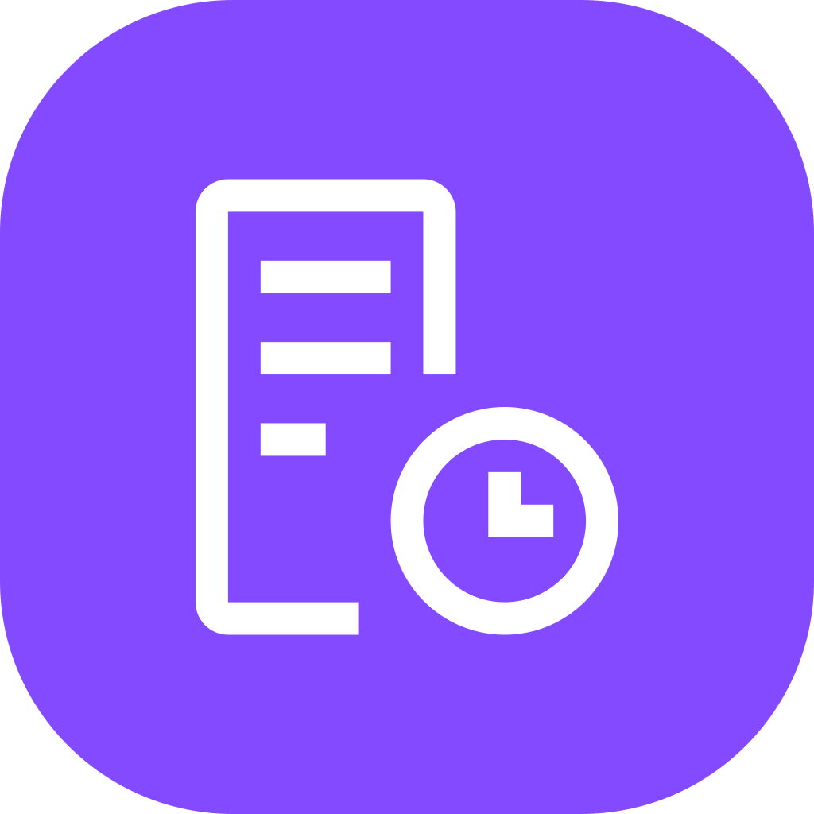
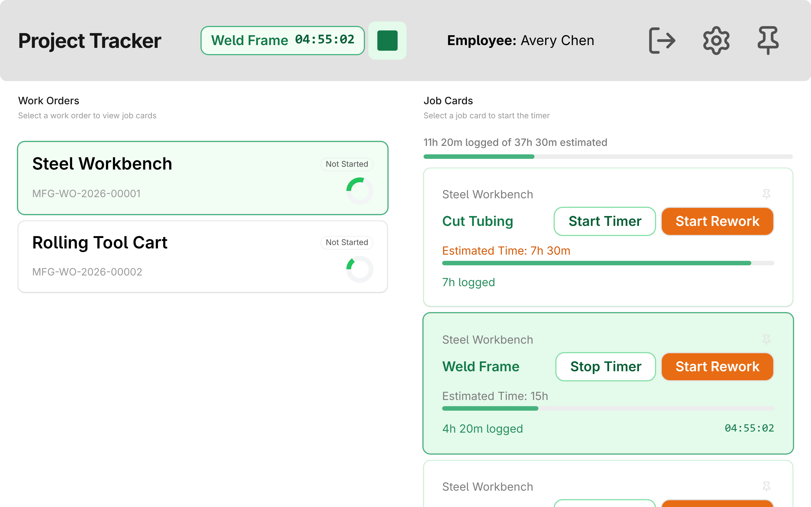

<!-- Copyright (c) 2026, Avunu LLC and contributors
For license information, please see license.txt-->

<!-- frappe-nix:begin header -->

<div align="center">



# Employee Timeclock

Badge-scan timeclock kiosks and job-card time tracking for ERPNext and HRMS

[](https://github.com/Avunu/employee_timeclock/actions/workflows/ci.yml)
[](https://github.com/Avunu/employee_timeclock/releases)
[](license.txt)
[](https://github.com/frappe/frappe/tree/version-16)

<picture>
  
</picture>

</div>

<!-- frappe-nix:end header -->

## Overview

Paper time cards and shared logins make payroll slow and hard to trust. Employee Timeclock puts a kiosk on a tablet or PC by the door: employees scan a badge to clock in and out, and the punches land in ERPNext as Employee Checkins. Each employee's punches for a day are gathered into one **Workday** record that HR reviews and corrects. On the shop floor, the same badge starts and stops timers on Job Cards, so labour time reaches the work order without anyone re-keying it.

It is for ERPNext sites that pay hourly staff and, optionally, track manufacturing labour. It needs ERPNext and HRMS.

## Features

- **Three kiosk pages**, none of which accept Guest:

  | Page                                                   | Who signs in                             | How an employee identifies                                          |
  | ------------------------------------------------------ | ---------------------------------------- | ------------------------------------------------------------------- |
  | `/employee-timeclock` (Employee Clock-in/out web form) | a kiosk user                             | scans their badge                                                   |
  | `/timeclock` (badge kiosk)                             | a kiosk user                             | scans their badge                                                   |
  | `/job_timeclock` (job time tracker)                    | a kiosk user, or the employee's own user | scans their badge at a kiosk; a signed-in employee is already known |

- **Badges.** HR issues a random badge token from the Employee form (_Timeclock → Issue Badge_) and prints it on the badge as a barcode or QR code. It is shown once and only its SHA-256 hash is stored; issuing again replaces it, and _Revoke Badge_ disables it. RFID tags in the Employee's _Attendance Device IDs_ table work too. An employee is never identified by their Employee ID, which is guessable.
- **Night shifts.** An IN pairs with the OUT that closes it, by log type and time, within a maximum shift length (16 hours unless changed in _Timeclock Settings_), and the shift's hours count on the IN's date. A shift from 10 PM to 6 AM is one shift on one Workday, and every kiosk treats the scan after midnight as its OUT. A punch that pairs with nothing is flagged as a missed punch and counts no hours.
- **The clock-in form** punches OUT while the employee has an IN open from the last maximum shift length and IN otherwise, or takes a date, a time and a Clock In / Clock Out choice when _Enter Time Manually_ is ticked. After a punch it shows the employee's name and their hours this week.
- **Workdays.** One Workday per employee per day holds the shifts that started that day, up to twelve in and out pairs, and the total hours. Punches update their Workday, and editing a Workday's times updates, adds or deletes the matching Employee Checkins. On the Workday form an OUT earlier than its IN is the next morning's, so a night shift is entered as _10:00 PM_ to _6:00 AM_. The Workday list has a **Bulk Add** button that enters the same punches for several employees on one date.
- **Workday Management report**, grouped by employee or by day. It shows every punch under the Workday of the shift it belongs to (a night shift's OUT reads _6:00 AM (+1)_) and flags each day as OK, Missing Punch, Out of Sync, Log Type Mismatch, No Workday, Duplicate Workday or No Punches. From the report HR can edit a punch's time in the grid (an OUT moves to that time after its IN, past midnight if need be), set an OUT's hours, add and delete punches, rebuild Workdays from the punches, and jump to this week, last week or this month.
- **Job time tracker.** An employee picks an open work order, sees each operation's estimated and logged time, and starts or stops a timer that is written to the operation's Job Card as a time log. Starting a timer stops the employee's open one. **Start Rework** logs time to a corrective Job Card. Employees can pin the jobs they use most (the pins are kept in that browser), and a kiosk can be set to put its own workstations' operations first.
- **Machine time.** An Operation marked _Is Machine Time_ is timed against the machine: the person who started it is recorded as the time log's _Machine Operator_, and only members of the operation's _Machine Employee Group_ see it. Running machine timers show in a bar along the bottom of the tracker.
- **Reports:** Workday Payroll Report (regular and overtime hours per employee, from Workdays), Payroll Report and Work Day Hours Report (from Employee Checkins, paired into shifts the same way, with a Missed Punch flag), and the Punch List. Weeks run Sunday to Saturday, and a week that spans New Year's Day is one week.
- **Kiosk safety.** Only Active employees can clock in, badge scans are rate limited per client IP (30 a minute), and an unrecognised badge gets the same answer whatever the reason, so a kiosk never reveals whether an employee exists.
- An **Employee Timeclock** tile on the desk's apps screen, for users who can read Workdays.

<!-- frappe-nix:begin compatibility -->

## Compatibility

| Frappe | Branch       |
| ------ | ------------ |
| v16    | `version-16` |

| Requires                                     | Version            |
| -------------------------------------------- | ------------------ |
| [erpnext](https://github.com/frappe/erpnext) | `>=16.0.0,<17.0.0` |
| [hrms](https://github.com/frappe/hrms)       | `>=16.0.0,<17.0.0` |

<!-- frappe-nix:end compatibility -->

<!-- frappe-nix:begin installation -->

## Installation

On Frappe Cloud, install Employee Timeclock from the [Frappe marketplace](https://cloud.frappe.io/marketplace/apps/employee_timeclock).

On a bench of your own:

```bash
bench get-app https://github.com/Avunu/employee_timeclock --branch version-16
bench --site <site> install-app employee_timeclock
```

<!-- frappe-nix:end installation -->

The `version-16` branch still holds 16.0.0, from before the app was renamed from `timeclock`. Until the next release moves it, install from `main` instead: `bench get-app https://github.com/Avunu/employee_timeclock --branch main`.

## Upgrading

`bench migrate` runs the app's patches. One of them changes payroll hours, so read this before upgrading a site that already has Workdays.

**Rebuilding Workdays for night shifts** (`employee_timeclock.patches.rebuild_workdays_for_night_shifts`). Workdays used to hold the punches of one calendar date, paired by position whatever their log type. Now a shift is an IN and the OUT that closes it, and it belongs to the IN's date. The patch rebuilds the existing Workdays that way, through the same code as _Rebuild Workdays_ in the Workday Management report:

- **What changes.** Only a Workday whose slots or total hours differ from its punches' shifts, or whose punches are not yet linked to it, is rewritten: its twelve in and out slots, their times and its _Total Hours_. A night shift's OUT moves from the next day's Workday onto the day the shift started, so the first day gains the shift's hours and the next day loses the lone OUT. A day whose punches did not alternate IN, OUT is paired by log type, so two INs in a row now leave the first one a missed punch with no hours where they used to be paired. On the Employee Checkins of the rebuilt days it sets _Workday_ to the day's Workday, and gives a punch with no log type the one it paired as. It creates and deletes no Workday or Employee Checkin, never touches a punch's time, and runs none of the Workday or Employee Checkin hooks.
- **Workdays that trade punches change together.** When a night shift's OUT moves from one Workday onto the one before, both are rebuilt in one step or neither is, so no punch ever shows on two Workdays or drops off both. A run of night shifts chains its Workdays this way.
- **Only the last two weeks, by default.** The patch only rebuilds Workdays dated on or after a floor date, so payroll history that is already paid is not rewritten. When the site config key `employee_timeclock_rebuild_workdays_from` (`YYYY-MM-DD`) is set, it is the floor, earlier than the default to rebuild further back or later to rebuild less: `bench --site <site> set-config employee_timeclock_rebuild_workdays_from 2026-09-01`. Otherwise the floor is the site's date minus 14 days. Workdays before the floor are never written. A night shift that starts the day before the floor and ends on it is left alone on both days, so its OUT is neither dropped nor shown twice.
- **What it leaves alone.** Every Workday before the floor. Every Workday in a payroll period that has a draft or submitted Salary Slip for its employee (a cancelled slip does not count). Any Workday that trades punches with one of those, with one before the floor, or with a date that has punches but no Workday, since rebuilding it alone would count a punch twice or drop it. A Workday whose group shows a time that no Employee Checkin backs (hours typed straight into the Workday), since the rebuild would wipe it. Of duplicate Workdays for one employee and date, only the oldest is rebuilt, as _Rebuild Workdays_ does. Workdays that already match their punches are not written at all.
- **Audit.** Each rebuilt Workday gets an Info comment with its hours before and after. `bench migrate` prints a summary (Workdays checked, rebuilt and left alone, total hours before and after, and the names of out-of-date Workdays it left alone), which also goes to the `employee_timeclock.patches` log. It counts the Workdays before the floor and how many of them are out of date. HR can rebuild the ones it left alone from the Workday Management report once payroll for that period is settled.
- **Rebuilding older Workdays later.** Use _Rebuild Workdays_ in the Workday Management report for the employees and dates to rebuild. Or set the floor to an earlier date and run the patch again (it is safe to rerun): `bench --site <site> set-config employee_timeclock_rebuild_workdays_from 2026-01-01`, then `bench --site <site> execute employee_timeclock.patches.rebuild_workdays_for_night_shifts.execute`. Salary Slip periods are still left alone.
- **Safety.** It works one employee at a time and commits after each, so a large site is never held in one transaction. A Workday that fails to rebuild is rolled back with the Workdays it trades punches with, logged to the Error Log and counted, and the rest go on. Running it again rewrites nothing that is already up to date, so a migrate that stops partway can simply be run again.

A new site gets no rebuild: installing the app marks its patches as done.

## Configuration

1. **Create the kiosk user.** In _User_, add a user for the kiosk device (one per device makes it easy to revoke one), as a _Website User_, with only the **Timeclock Kiosk** role. The app installs that role. Give it a strong password.
2. **Issue badges.** For each employee who will clock in, open the Employee and choose _Timeclock → Issue Badge_ (HR Manager or System Manager only). Print the token shown on the employee's badge as a barcode or QR code that the kiosk's scanner reads. Issuing again replaces the badge; _Timeclock → Revoke Badge_ disables it for a lost badge or a leaver. Employees who already badge in with an RFID tag in _Attendance Device IDs_ keep working without a new badge.
3. **Sign the kiosk in.** On the kiosk device, open the kiosk page, sign in as the kiosk user and leave the browser on that page. The scanner must type the badge into the page like a keyboard, ending with Enter, as most USB scanners do by default.

**Night shifts.** _Timeclock Settings_ (HR Manager or System Manager) holds the **Maximum Shift Length**, 16 hours by default. An OUT closes the employee's open IN only within that many hours of it, and the kiosks treat an IN older than that as a forgotten clock-out. Raise it if anyone works longer shifts (up to 48 hours), lower it to flag forgotten clock-outs sooner.

For job time tracking:

- Employees who use the tracker from their own desk login need their user set in the Employee's _User ID_.
- To time an operation against a machine, tick _Is Machine Time_ on the Operation and set its _Machine Employee Group_ to the Employee Group of the people who run it.
- On a kiosk, the tracker's settings panel (the gear) picks the workstations at that kiosk. The choice is kept in the browser, and _My Station_ then shows only their operations.

## How It Works

- Every punch is an **Employee Checkin**. Its _Device ID_ says where it came from: `Employee Clock-in/out Device` (the web form), `Timeclock Scanner` (the badge kiosk) or `Workday Management` (a Workday edit or the report).
- Punches pair into shifts in `employee_timeclock/timeclock/shifts.py`, which every kiosk, the Workday sync and the hours reports use. Taken in time order, an OUT closes the employee's open IN if it is no more than the maximum shift length after it; a second IN leaves the first one unmatched, and an OUT with no open IN is unmatched. A shift belongs to its IN's date (an unmatched OUT to its own), and a punch with no log type is read as the OUT of an open IN, else an IN. Reading a date range, the punches a maximum shift length either side are read too, so a night shift at either end of the range is paired whole.
- The web form posts the scanned badge to `employee_timeclock.timeclock.api.submit_checkin`. The server resolves the badge, picks IN or OUT by the employee's open IN, ignores a second scan in the same minute and returns the employee's hours this week. Frappe's own web form submit is refused for this form, so a punch can't be made for an Employee ID typed into the form.
- The badge kiosk and the job tracker exchange a badge for a 30-minute JWT (`authenticate_employee`), signed with the site's `encryption_key` (a site that has none gets one, saved to its `site_config.json`, the first time a badge is scanned), and send it with each call; the job tracker's calls return a refreshed token, so an active session keeps going. Signing out of the tracker does not stop a running timer. The badge kiosk then punches OUT while the employee has an IN open from the last maximum shift length, and IN otherwise, as the clock-in form does.
- `doc_events` keep Workdays and Employee Checkins in step. A new, changed or deleted Employee Checkin rebuilds every Workday it can belong to or re-pair: the dates a maximum shift length either side of it, so a night shift's OUT updates the day before, and an IN added or deleted before a next-morning OUT moves that OUT on or off the next day's Workday; saving a Workday parses its `h:mm AM/PM` times (an OUT earlier than its IN being the next day's), recalculates the total and rewrites the Employee Checkins of the shifts that belong to its date, keeping a moved punch's original time in _Overridden Time_.
- The job tracker's timers are Job Card Time Logs. `TimeclockJobCard` (an `extend_doctype_class` on Job Card) moves the employee to _Machine Operator_ on machine-time cards, skips ERPNext's overlap check for the tracker's own saves (it closes the employee's open timers itself), and enforces the operation sequence only once a card reports a completed quantity. Machine timer starts and stops are broadcast over Frappe's realtime socket, so every open tracker updates.
- The kiosk SPAs are Vue 3 and frappe-ui, built with Vite by `yarn build` (which `bench build` runs) and loaded by the `www` pages.

## Limitations

- A Workday holds at most twelve in and out pairs.
- A shift can't be longer than the maximum shift length: an IN and an OUT further apart are two missed punches. When an employee forgets to clock out and clocks in again within that time, the first IN is the missed punch and the second pairs with the next OUT.
- Workdays built before night shifts were paired are rebuilt by `bench migrate` (see [Upgrading](#upgrading)), except those older than the last two weeks (or the date set in `employee_timeclock_rebuild_workdays_from`), those in a payroll period that has a Salary Slip and those that share a night shift with a Workday it can't rebuild. Those keep the punches of one calendar date: the Workday Management report shows such a day as Out of Sync, and _Rebuild Workdays_ moves a night shift's OUT onto the day it started.
- In the Workday Management report, the OUT of a night shift is added with _Add Punch_ on the next day's date; the blank punch row under a day adds a punch on that date.
- Saving a Workday rewrites only the punches of its own date. If that edit re-pairs a punch on a neighbouring day (for example a new 10:00 PM IN that now closes with a lone 6:00 AM OUT the next morning), the neighbouring Workday is not rebuilt; the Workday Management report shows it as Out of Sync, and _Rebuild Workdays_ fixes it.
- A punch recorded less than a minute after its Workday was created or saved is not copied into the Workday; this guard stops the two sync hooks from triggering each other. The Workday Management report shows the day as Out of Sync, and _Rebuild Workdays_ fixes it.
- Overtime in the payroll reports is hours over 40 in a week, and the 40 can't be configured. A week runs Sunday to Saturday, whatever the site's first day of the week.
- The kiosk pages are in English only and have no dark theme. The job tracker's page is titled "Project Tracker".
- The old job time tracker at `/job_timeclock_legacy` still ships; it is replaced by `/job_timeclock` and will be removed.

<!-- frappe-nix:begin support -->

## Support

- Bug reports and questions: [GitHub issues](https://github.com/Avunu/employee_timeclock/issues)
- E-mail: <mail@avu.nu>

<!-- frappe-nix:end support -->

<!-- frappe-nix:begin development -->

## Development

```bash
nix develop        # or: direnv allow
prek install       # the git hooks CI runs
frappe-test        # the tests, the way CI runs them
```

The managed files, checks and release flow are described in the [app standards documentation](https://docs.avunu.net/frappe-nix/docs/app-standards/).

<!-- frappe-nix:end development -->

The build commands, the source layout and the rename shim are described in [docs/development.md](docs/development.md).

<!-- frappe-nix:begin license -->

## License

MIT, Copyright (c) 2022–present Avunu LLC → [license.txt](license.txt)

<!-- frappe-nix:end license -->
