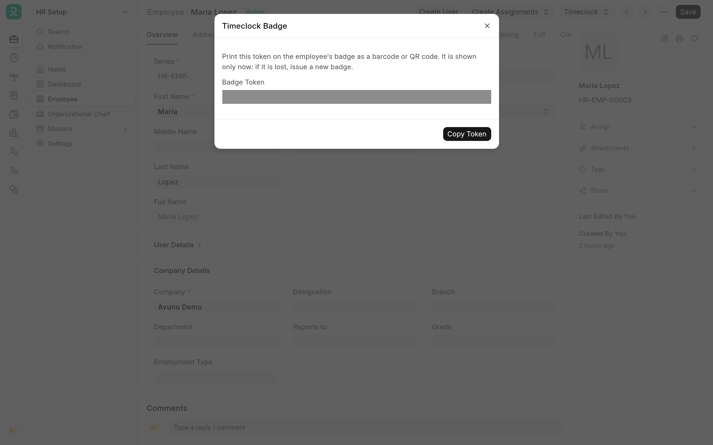
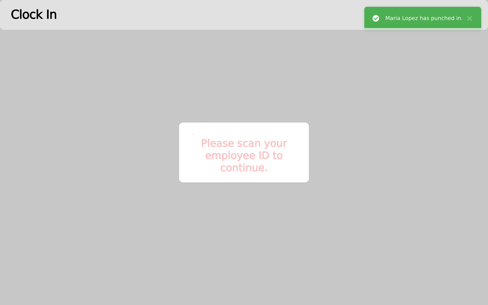
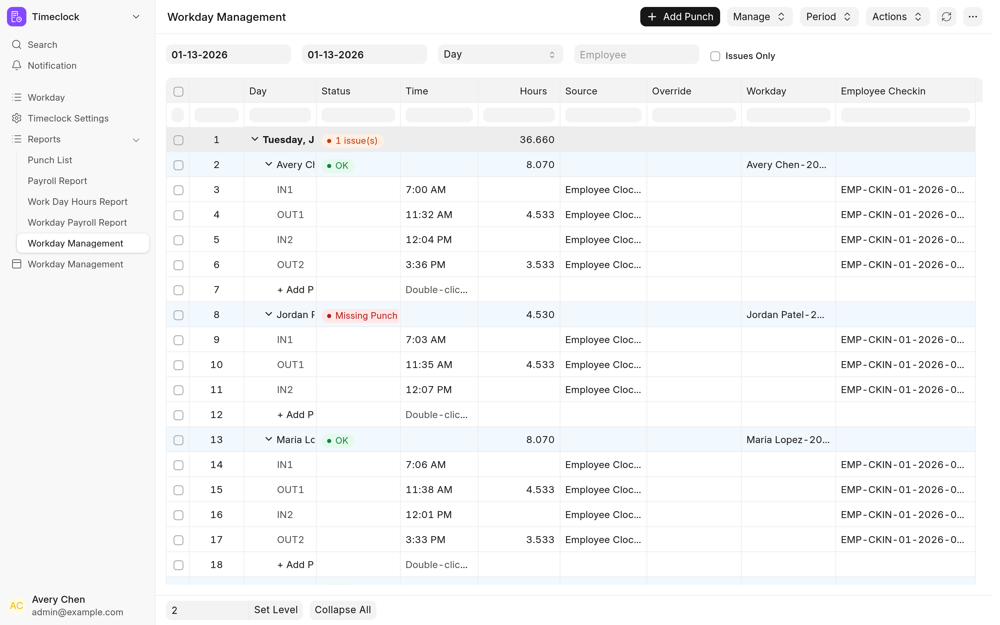

Paper time cards and shared logins make payroll slow and hard to trust. Employee Timeclock puts a kiosk on a tablet or PC by the door: employees scan a badge to clock in and out, and each punch lands in HRMS as an Employee Checkin. Each employee's punches for a day are gathered into one **Workday** record that HR reviews and corrects. On the shop floor, the same badge starts and stops timers on ERPNext Job Cards, so labour time reaches the work order without anyone typing it in again.

It is for ERPNext sites that pay hourly staff and, optionally, track manufacturing labour. It runs on Frappe v16 with ERPNext and HRMS, and is free software under the [MIT licence](../license.txt).

## What you get

### Badges that HR issues

HR issues each employee a random badge token from the Employee form and prints it on the badge as a barcode or QR code. Only a hash of the token is stored, and RFID tags registered on the Employee work too. An employee is never identified by their Employee ID. See [Issue and revoke badges](badges.md).

### Kiosks to clock in and out

Two kiosk pages record punches: the badge kiosk at `/timeclock` and the Employee Clock-in/out form at `/employee-timeclock`, which can also take a time entered by hand. Both run signed in as a kiosk user and decide by themselves whether a scan is an IN or an OUT, night shifts included. See [Clock in and out](clock-in.md).

### Workdays that HR reviews

One Workday per employee per day holds the shifts that started that day and their total hours, and stays in step with the Employee Checkins. The Workday Management report flags missing punches and days out of step, and lets HR edit, add and delete punches in place. See [Review and correct Workdays](workdays.md).

### Time tracked on Job Cards

The job time tracker at `/job_timeclock` lists open work orders and their operations. An employee starts and stops a timer, or a rework timer, and the time is written to the operation's Job Card as a time log. Operations can be timed against a machine instead of a person. See [Track time on job cards](job-tracker.md).

### Payroll reports

Four reports turn punches and Workdays into hours: regular and overtime hours per employee, hours per day, and a list of punches. See [Payroll reports](payroll-reports.md).

## Where to start

| You are                                 | Read                                                                                                                           |
| --------------------------------------- | ------------------------------------------------------------------------------------------------------------------------------ |
| An employee clocking in                 | [Clock in and out](clock-in.md)                                                                                                |
| An employee timing work on job cards    | [Track time on job cards](job-tracker.md)                                                                                      |
| HR, reviewing hours and running payroll | [Review and correct Workdays](workdays.md), [Payroll reports](payroll-reports.md) and [Issue and revoke badges](badges.md)     |
| The administrator setting it up         | [Install and upgrade](install.md), [Configuration](configuration.md) and [Limitations and troubleshooting](troubleshooting.md) |
| A developer changing the app            | [Development](development/README.md) and [How it works](development/architecture.md)                                           |

## Requirements

- A bench with Frappe v16. The app declares `frappe >=16.0.0,<17.0.0`.
- ERPNext and HRMS v16 on the same site (`>=16.0.0,<17.0.0` each). Install ERPNext, then HRMS, then Employee Timeclock: the app's `required_apps` are `erpnext` and `hrms`.
- Node 24 or newer and yarn on the machine that builds the app. `bench build` runs the app's `yarn build`, which builds the two kiosk pages.
- A badge scanner, or an RFID reader, that types what it reads into the page like a keyboard and ends with Enter, for each kiosk.

> [!NOTE]
> These pages describe the code in the repository. Where a statement depends on Frappe's, ERPNext's or HRMS's own behaviour, it was checked against Frappe 16.52, ERPNext 16.51 and HRMS 16.51.

## Source and changes

The source is at [github.com/Avunu/employee_timeclock](https://github.com/Avunu/employee_timeclock). Each release is listed on the [releases page](https://github.com/Avunu/employee_timeclock/releases), and the [changelog](../CHANGELOG.md) lists what changed in each.
