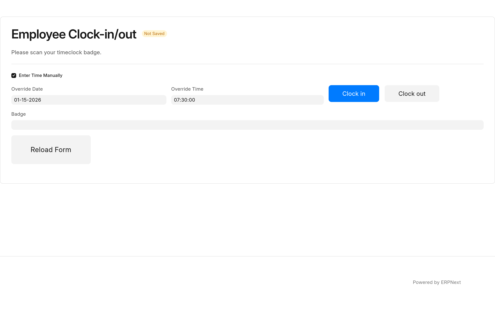

Two kiosk pages record punches. Each runs in a browser signed in as a **Timeclock Kiosk** user (see [Set up a kiosk](configuration.md#set-up-a-kiosk)), and each records an Employee Checkin for the employee whose badge was scanned.

| Page                                                      | What it records                                                                                         | **Location / Device ID**       |
| --------------------------------------------------------- | ------------------------------------------------------------------------------------------------------- | ------------------------------ |
| `/timeclock`, the badge kiosk                             | A punch at the moment of the scan                                                                       | `Timeclock Scanner`            |
| `/employee-timeclock`, the Employee Clock-in/out web form | A punch at the moment of the scan, or at a date and time the employee enters, and their hours this week | `Employee Clock-in/out Device` |

The job time tracker at `/job_timeclock` uses the same badge to sign in, but it times work on Job Cards and records no punch: see [Track time on job cards](job-tracker.md).

## IN or OUT: the kiosk decides

You never choose IN or OUT when you scan. A scan is an **OUT** while you have an IN open from the last maximum shift length (16 hours unless HR changed it in Timeclock Settings), and an **IN** otherwise.

So a night worker who clocks in at 10:00 PM and scans again at 6:00 AM is clocked out, and the shift counts on the day it started. A clock-out you forgot more than the maximum shift length ago does not turn your next morning's scan into an OUT: it is an IN, and the old IN shows HR a missed punch. [How punches pair into shifts](workdays.md#how-punches-pair-into-shifts) has the full rule.

## Use the badge kiosk

1. The kiosk shows "Please scan your employee ID to continue."
2. Scan your badge.
3. A message confirms the punch: "Maria Lopez has punched in." or "Maria Lopez has punched out."

Each scan is a punch, so scan once. A second scan right after the first records the opposite punch. Clicking the **Clock In** heading reloads the page.

## Use the Employee Clock-in/out form

The form asks "Please scan your timeclock badge." with the cursor in **Badge**, under a clock showing the time and date.

1. Scan your badge into **Badge**. The form records the punch as soon as the scan ends; there is nothing to click.
2. A message confirms it, for example "Clocked in! Maria Lopez, you have logged 32.5 hours this week."

A second scan by the same employee within the same minute keeps the punch already recorded and records nothing new.

The weekly hours are the sum of your Workdays' **Total Hours** from the first day of this week, as set by **First Day of the Week** in System Settings (Sunday by default), to six days later.

### Enter the time by hand

When an employee forgot to punch, they can enter the time at the form:

1. Tick **Enter Time Manually**.
2. Pick the date in **Override Date** (today by default) and the time in **Override Time**.
3. Choose **Clock in** or **Clock out**.
4. Scan your badge into **Badge**.

The punch is recorded with **Manual Override** ticked, and the Workday Management report shows it as **Manual** in the **Override** column. A time in the future is refused with a "Time Traveler!" message, and no punch is recorded.

**Reload Form** clears the form. The form also reloads itself every hour.

## Where the punch goes

Every punch is an Employee Checkin with a log type, IN or OUT. Saving it updates the employee's Workday for the day the shift started, and creates that Workday when there is none yet: the Workday list and the Workday Management report show the result. See [Review and correct Workdays](workdays.md).

## If a scan is refused

| The kiosk says                                                                    | What it means                                                                                                                                      |
| --------------------------------------------------------------------------------- | -------------------------------------------------------------------------------------------------------------------------------------------------- |
| "Badge not recognised."                                                           | The badge is unknown, revoked, or belongs to an employee who is not Active. Ask HR to [issue a badge](badges.md).                                  |
| "The scan was not recorded. Please scan your badge again."                        | The badge kiosk's request failed: too many scans in a minute, the kiosk user was signed out, or a server error. No punch was recorded.             |
| "Maria Lopez was unsuccessfully logged in." or "... was not properly signed out." | The badge was recognised but the punch could not be saved. The error is in the site's Error Log, titled "Timeclock punch failed for" the employee. |

[Limitations and troubleshooting](troubleshooting.md#troubleshooting) has the rest.
